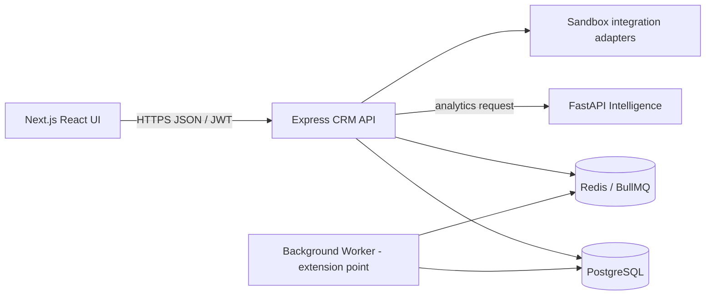

# Architecture

## Ownership
- Express + PostgreSQL own users, leads, contacts, companies, opportunities, activities, workflows and audit records.
- FastAPI is stateless: it computes analytics from request payloads and does not persist authoritative CRM entities.
- Redis is for transient cache/queue state only.
- The browser never connects directly to PostgreSQL.

## Security boundaries
- JWT authentication on protected routes.
- Role middleware for privileged operations.
- Zod server-side validation.
- Helmet, CORS configuration, and basic rate limiting.
- Passwords stored as bcrypt hashes.
- Secrets supplied through environment variables.

Production hardening still required: refresh-token rotation/revocation, tenant-scoped database constraints and policies, robust audit coverage, CSRF strategy if cookie auth is introduced, secret manager, structured logging, metrics, and security review.
