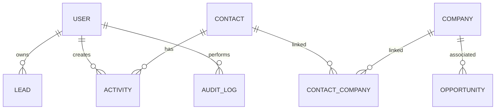

# Data model

`ContactCompany` is a join table supporting the required many-to-many contact/company relationship. Opportunity team collaboration and custom-field metadata are identified extension points; add `OpportunityMember` and `CustomFieldDefinition/Value` tables when implementing those expanded requirements.
